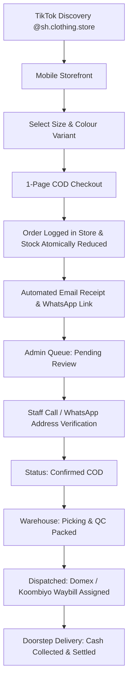

# SH Clothing Store — Full E-Commerce Platform

> **Project Research Document Implementation**  
> **Prepared for:** SH Clothing Store  
> **Prepared by (Developer):** Nivandana Dikeshi  
> **Assigned by:** Pixzora Labs (Pvt) Ltd.  
> **TikTok Profile:** [@sh.clothing.store](https://www.tiktok.com/@sh.clothing.store?_r=1&_t=ZS-9AjmuI3ue0s)  

---

## 🌟 Executive Summary & Features

**SH Clothing Store** is a specialized fashion retail platform designed for selling exported clothing overruns, high-street samples, and viral contemporary drops across **Sri Lanka** utilizing a seamless **Cash on Delivery (COD)** checkout model.

### 🛍️ Public Storefront Features (Mobile-First):
- **Hero Editorial Section:** Custom campaign visuals, trust badges, and quick social drop links.
- **Dynamic Category Explorer:** Dresses & Coordinates, Tops & Heavyweight Tees, Trousers & Denim, Outerwear & Jackets, Bags & Accessories.
- **TikTok Viral Drops Collection:** Direct mapping from TikTok video showcase to instantaneous web checkout.
- **Search & Multi-Faceted Filtering:** Instant SKU and name search, category tabs, size pills (XS–XXL), color swatches, and price slider.
- **Rich Product Detail Pages:** High-resolution image galleries, live stock alerts ("Only 2 left!"), size & fit guide modal, fabric/care instructions, and related items.
- **Slide-out Cart Bag & Full Cart Review:** Free shipping meter progress bar (unlocked at Rs. 10,000), promo coupons (`TIKTOK10`, `SHWELCOME`), and order notes.
- **1-Page Streamlined COD Checkout:** Doorstep delivery across all 25 districts of Sri Lanka with Colombo express (Rs. 350) and Islandwide standard (Rs. 450) automated fee calculation. Modular architecture ready for future Card/PayHere/Stripe integration.
- **Celebratory Order Confirmation:** Confetti animation, order reference generator (`SH-2026-XXXX`), live 5-stage fulfilment pipeline, printable receipts, and direct WhatsApp confirmation button.
- **Customer Live Order Tracking:** Real-time lookup by Order Reference or phone number with assigned courier waybill tracking.
- **Customer Care & Policies:** Comprehensive About Us, Shipping & COD Terms, 7-Day Size Exchange policy, FAQ accordion, and floating WhatsApp widget.

### 🛡️ Back-End Admin Management System (`/admin`):
- **Role-Based Access Control (RBAC):** Switchable roles with enforced privileges:
  - *Owner / Super Admin:* Full access to analytics, settings, users, and audit logs.
  - *Store Manager:* Product catalogue, inventory, orders, and customer service.
  - *Order Staff:* Verification calls, dispatch notes, courier waybill assignments.
  - *Content Staff:* Descriptions, imagery, and promotional tags.
- **Operational Dashboard:** Live revenue KPIs, pending COD queue, courier in-transit metrics, and low-stock alerts.
- **Order Management Hub:** Status pipeline transitions (*Pending Review* → *Confirmed COD* → *Processing* → *Packed* → *Dispatched* → *Delivered* → *Completed*), exception handling with **automatic stock restoration** for cancellations, courier partner assignments (Domex, Koombiyo, PromptX, Pronto), internal notes, and printable packing slips.
- **Inventory & Variant SKU Matrix:** Granular stock tracking per size/colour SKU, atomic inline adjustments, reason logs (*Received Shipment*, *Damaged*, *Physical Audit*), and movement history audit trail.
- **Product Catalogue Manager:** Create, edit, and archive garments with variant matrix and TikTok viral toggles.
- **Customer Directory:** Track repeat-order frequencies, contact details, and lifetime COD spend.
- **Settings & Integrations:**
  - *Marketing Pixels:* Configurable TikTok Pixel ID and Meta Pixel ID with **Live Event Diagnostics Inspector**.
  - *Transactional Email:* Resend API configuration, customer order confirmation HTML receipt generator, and preview modal.
  - *Delivery Rates:* Configurable Sri Lanka district fees and free delivery thresholds.

---

## 🛠️ Technology Stack

- **Framework:** Next.js 14 (App Router)
- **Language:** TypeScript 5
- **Styling:** Bespoke Vanilla CSS Design System (High-fashion aesthetic, glassmorphism, responsive ergonomics)
- **Database & Backend:** Firebase (Cloud Firestore, Auth, Storage) + Built-in offline resilient reactive fallback store
- **Email:** Resend API (Transactional HTML order receipts)
- **Analytics & Social:** TikTok Pixel & Meta Pixel Universal Event Layer with deduplication
- **Icons:** Lucide React
- **Celebration Effects:** Canvas Confetti

---

## 🚀 Getting Started

### 1. Install Dependencies
```bash
npm install
```

### 2. Configure Environment Variables
Copy `.env.example` to `.env.local`:
```bash
cp .env.example .env.local
```
*(The platform runs seamlessly out-of-the-box in development mode even without API keys!)*

### 3. Run Development Server
```bash
npm run dev
```
Open [http://localhost:3000](http://localhost:3000) to view the storefront, or [http://localhost:3000/admin](http://localhost:3000/admin) to access the Admin Management Panel.

---

## 📦 Operational COD Workflow Summary



---

## 📄 License & Credits
- Built for **Pixzora Labs (Pvt) Ltd.**
- Created by **Nivandana Dikeshi** for **SH Clothing Store Sri Lanka**.
